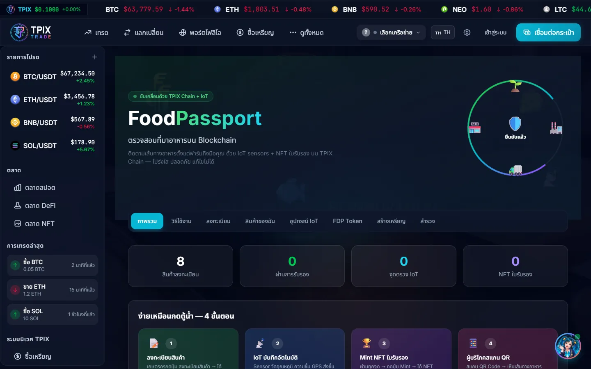
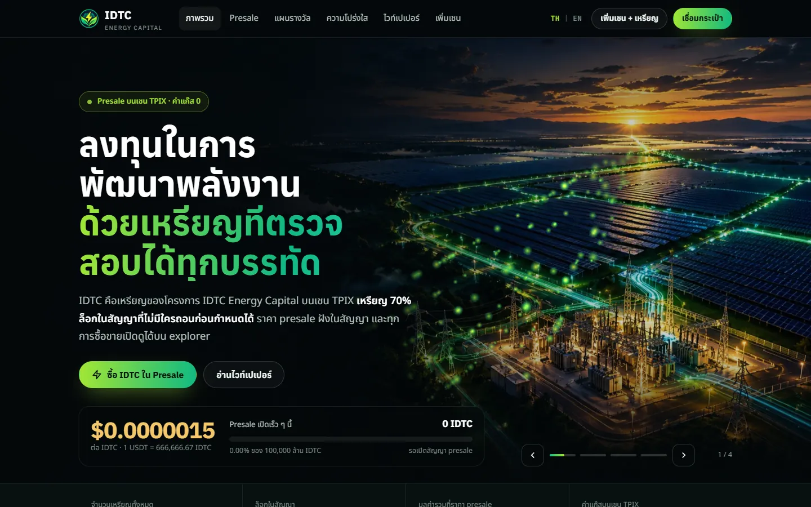
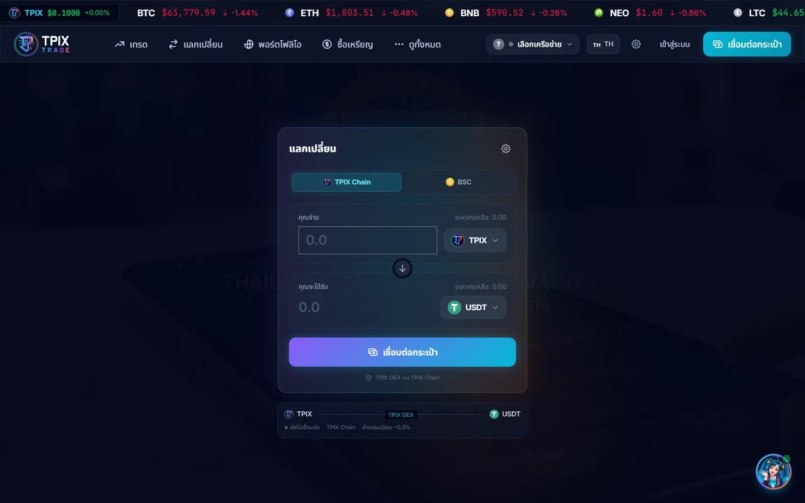
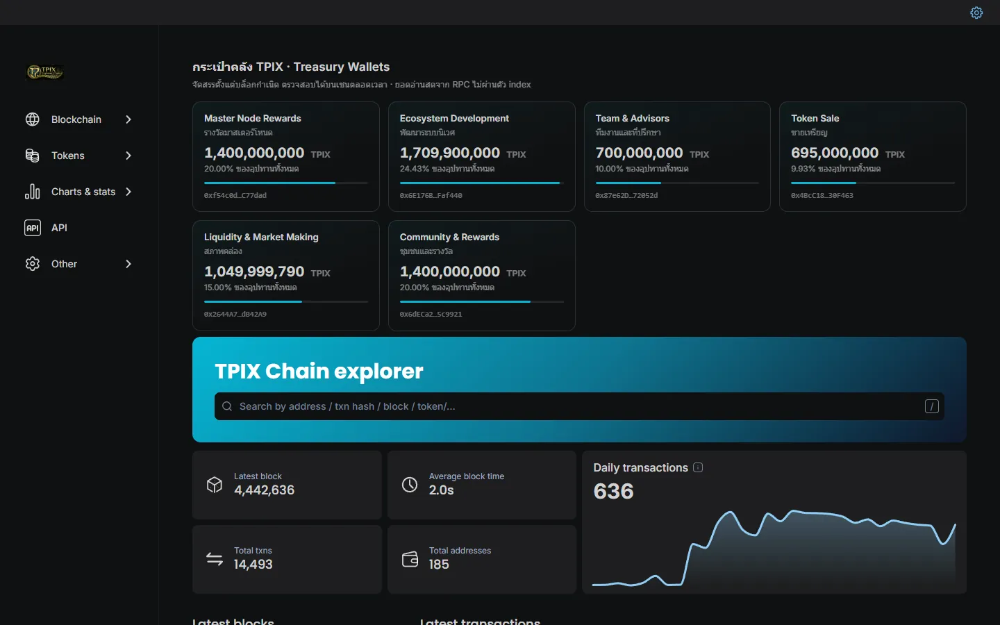
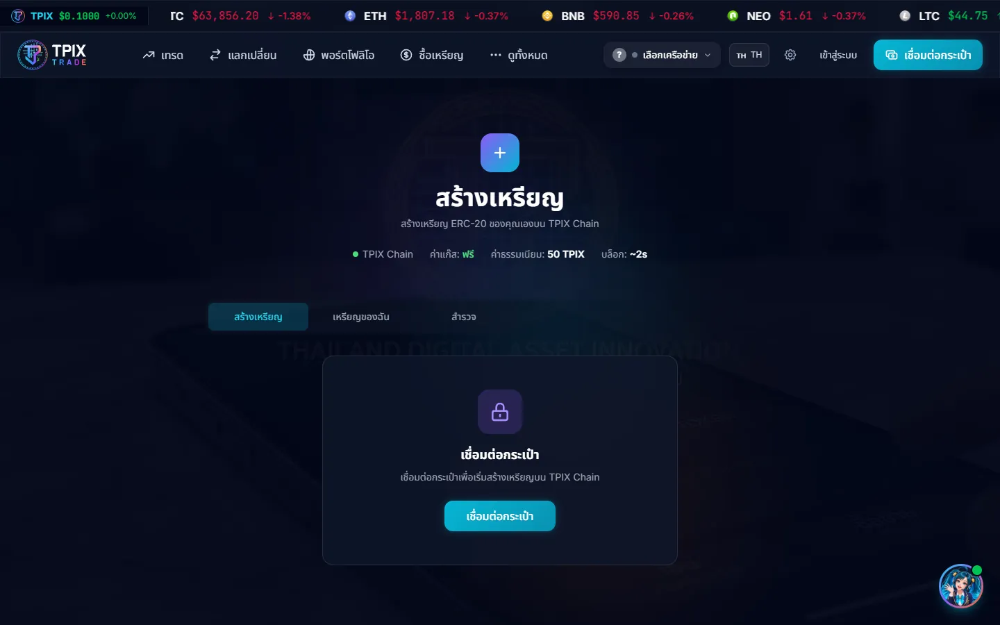
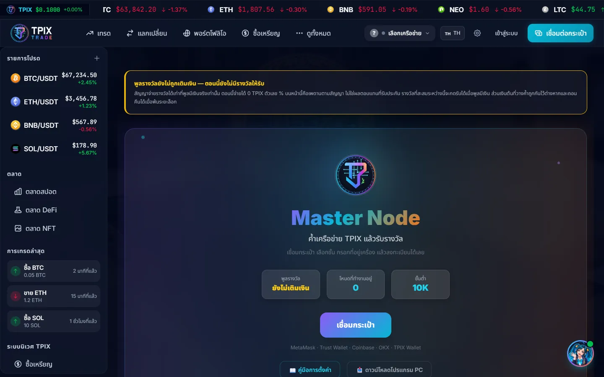

<p align="center">
  
</p>

<p align="center">
  
</p>

<h1 align="center">TPIX Chain</h1>

<p align="center">
  <strong>An independent, zero-gas EVM Layer 1 for the Thai and ASEAN digital economy</strong><br/>
  Zero gas fees · 2-second blocks · IBFT 2.0 instant finality · EVM / Solidity compatible
</p>

<p align="center">
  <a href="https://tpix.online"></a>
  <a href="https://explorer.tpix.online"></a>
  <a href="https://tpix.online/whitepaper"></a>
  <a href="#security--trust"></a>
  <a href="https://github.com/xjanova/TPIX-Coin/releases"></a>
</p>

<p align="center">
  <a href="https://chainlist.org/chain/4289"></a>
  
  
  
  
</p>

<p align="center">
  <a href="#live-on-tpix-chain">Live projects</a> ·
  <a href="#security--trust">Security &amp; trust</a> ·
  <a href="#chain-specifications">Specs</a> ·
  <a href="#deployed-contracts">Contracts</a> ·
  <a href="#tokenomics">Tokenomics</a> ·
  <a href="#roadmap">Roadmap</a> ·
  <a href="#connect--build">Build on TPIX</a>
</p>

---

## Overview

TPIX Chain is an EVM-compatible **Layer 1** built on Polygon Edge with IBFT 2.0 consensus. It is run as an independent chain — not a rollup and not tied to a parent chain's rules or fees — so transactions stay **free**, blocks land every **2 seconds**, and the design can follow what real Thai businesses need: food traceability, energy projects, payments and trading.

The native coin **TPIX** has a fixed supply of **7,000,000,000** minted in genesis (18 decimals). There is no inflation beyond genesis; master-node rewards are paid from a pre-allocated pool.

What this README promises, it shows: every contract below links to verified source on the explorer, treasury balances are readable from public RPC, and the [Security &amp; Trust](#security--trust) section lists what is done **and what is not yet done**.

| | |
|---|---|
| **Chain ID** | `4289` (mainnet) · `4290` (testnet) |
| **Block time / finality** | 2 s · final when sealed (IBFT) |
| **Gas price** | 0 — free, set in genesis |
| **Consensus** | IBFT 2.0 Proof-of-Authority, 4 validators today |
| **Current chain since** | 6 Aug 2026 (re-genesis on a new host; earlier state discarded) |
| **Explorer** | [explorer.tpix.online](https://explorer.tpix.online) (Blockscout) |

---

## Live on TPIX Chain

Real products running on the chain today. Screenshots are from the live sites.

<table>
  <tr>
    <td width="50%" valign="top">
      <a href="https://tpix.online/food-passport"></a>
      <h3>🍲 FoodPassport</h3>
      Farm-to-table food traceability. Producers register products, IoT readings are recorded, and quality certificates are written on chain so a shopper can scan a QR code and see the trail. <b>Status: live</b> — on-chain certificates since Nov 2026.
    </td>
    <td width="50%" valign="top">
      <a href="https://tpix.online/use-cases"></a>
      <h3>⚡ IDTC Energy Capital</h3>
      An energy-development token launched through the TPIX Launchpad: presale price fixed in the contract, most of the supply locked in on-chain vesting, every trade visible on the explorer. <b>Status: launchpad contracts deployed and verified</b> (Nov 2026).
    </td>
  </tr>
  <tr>
    <td width="50%" valign="top">
      <a href="https://tpix.online/swap"></a>
      <h3>🏦 TPIX TRADE DEX</h3>
      Uniswap V2–style AMM on TPIX Chain with zero gas, plus a BSC route. WTPIX/USDT pool and a USDT bridge from BSC. <b>Status: live.</b>
    </td>
    <td width="50%" valign="top">
      <a href="https://explorer.tpix.online"></a>
      <h3>🔎 Explorer &amp; treasury transparency</h3>
      Self-hosted Blockscout with the six genesis allocation wallets shown on the home page, read live from RPC. <b>Status: live.</b>
    </td>
  </tr>
  <tr>
    <td width="50%" valign="top">
      <a href="https://tpix.online/token-factory"></a>
      <h3>🏭 Token &amp; NFT Factory</h3>
      Create ERC-20 (standard, utility, reward, governance, stablecoin) and ERC-721 tokens without writing code. <b>Status: live</b> (Factory V2).
    </td>
    <td width="50%" valign="top">
      <a href="https://tpix.online/masternode"></a>
      <h3>🖥️ Master Node network</h3>
      Stake TPIX, register a node in <code>NodeRegistryV2</code> and earn rewards. <b>Status: registry live; the reward pool is not funded yet</b> — the site says so on the page.
    </td>
  </tr>
</table>

Also built on TPIX: **TPIX Wallet** (Android, Living Identity seedless recovery), **AI TRADE** (non-custodial strategy bots), and the **Thaiprompt** commerce platform. The carbon-credit module is built but **switched off** until its verification partners are in place.

---

## Security & Trust

TPIX Chain runs itself, so it borrows security from no one. Trust has to be earned from three things:

1. **Verify, don't trust** — contract source is verified on the explorer; supply and treasury balances are readable from public RPC.
2. **No single point of control** — no organisation, the TPIX team included, should hold enough validators or admin keys to decide alone.
3. **Do what we announce** — major changes behind a timelock, a public emergency policy, and a post-mortem for every incident.

IBFT tolerates `f` faulty validators out of `n = 3f + 1` (4 → 1, 7 → 2, 10 → 3, 21 → 6). **Our rule:** no single organisation may hold more than `f` validators.

### Status today (28 Nov 2026)

| Measure | Status | Notes |
|---|---|---|
| Verified contract source | ✅ Done | 22 of 23 contracts in [`deployed-contracts.json`](contracts/deployed-contracts.json) are verified; `TPIXBridgeVault` verification is pending |
| Public supply & treasury APIs | ✅ Done | See [Transparency](#transparency--public-apis) |
| OpenZeppelin 5 + reentrancy guards | ✅ Done | Checks-effects-interactions or `ReentrancyGuard` on state-changing calls |
| Back-office 2FA + payout-address delay | ✅ Done | Mandatory TOTP for every admin; new payout addresses wait 24 h |
| App signing key rotated | ✅ Done | TPIX TRADE APK signed with a new RSA-4096 key, APK Signature Scheme v3 rotation |
| Bot wallet keys isolated | ✅ Done | Separate signing service; the web app never holds them |
| RPC rate limiting | ✅ Done | Protects a zero-gas chain from spam |
| Disclosure policy | ✅ Done | [SECURITY.md](SECURITY.md) — critical reports answered within 12 h |
| Internal security reviews | ✅ Done | e.g. [Aug 2026 review](docs/SECURITY-AUDIT-2026-08-05.md); further reviews in Oct and Nov 2026 |
| Validators on separate machines and providers | 🔄 In progress | Today all 4 validators are operated by the TPIX team |
| Contract admin → multisig + timelock | 🔄 In progress | Bridge, `USDT_TPIX` and `NodeRegistryV2` admin is a team wallet today (visible on chain) |
| Two-source bridge deposit checks + auto-pause | 🔄 In progress | For every bridge (USDT and wTPIX) |
| External audit | 📅 Planned | Bridge and tokens first; full report will be published |
| Bug bounty on Immunefi | 📅 Planned | Until then, high-impact reports are rewarded at the team's discretion |
| Proof of reserves | 📅 Planned | Live BSC-locked vs TPIX-minted comparison |
| Public status page | 📅 Planned | Block height, online validators, incident history |

### Four-phase plan

Each phase starts when its conditions are met — funding and partners — not on a fixed date.

| Phase | When | What happens |
|---|---|---|
| **0 · Remove single points of control** | Now | Validators on separate machines and providers · key contracts behind multisig + timelock · publish genesis, node config and validator list · public emergency policy |
| **1 · Run it professionally** | Once funded | Maintain our own Polygon Edge fork with back-ported security patches · reproducible builds · 7 validators across providers and countries · external audit, bug bounty, proof of reserves |
| **2 · Consortium** | As partners join | Partners run validators with their own keys · TPIX team holds ≤ 3 of 10 · validators added/removed by on-chain vote · threshold bridge signing · a stewarding entity separate from the developer |
| **3 · Open network** | As the network grows | PoA → PoS with slashing · token-holder governance behind a timelock · re-audit on every major upgrade · optional anchoring of block hashes on a public chain |

| Trust metric | Today | Phase 2 target | Phase 3 target |
|---|---|---|---|
| Independent validator operators | 1 (TPIX team) | 4+ organisations | Open to anyone |
| Validators held by the TPIX team | 100% | ≤ 30% | Lower still |
| Admin of key contracts | Team wallet | Multi-org multisig + timelock | DAO + timelock |
| External audits | None yet | Bridge + tokens | Every major upgrade |
| Bridge reserves | Checked internally | Public proof of reserves | Verifiable in real time |

Full chapter: **[Whitepaper §18 — Security &amp; Trust](https://tpix.online/whitepaper#security)**. Found a vulnerability? Email **security@tpix.online** — please do not open a public issue.

---

## Chain Specifications

| Parameter | Value |
|-----------|-------|
| **Chain name** | TPIX Chain |
| **Chain ID** | `4289` mainnet · `4290` testnet |
| **Client** | Polygon Edge v0.9 |
| **Consensus** | IBFT 2.0 (Istanbul Byzantine Fault Tolerant), Proof-of-Authority |
| **Validators** | 4 today (tolerates 1 faulty) |
| **Block time** | 2 seconds |
| **Finality** | Immediate once a block is sealed |
| **Gas price** | 0 (free — set in genesis) |
| **VM** | EVM — Solidity, ERC-20 / ERC-721 |
| **Native coin** | TPIX, 18 decimals |
| **Total supply** | 7,000,000,000 TPIX, minted in genesis, fixed |
| **Public RPC** | `https://rpc.tpix.online` (browsers / wallets) · `https://rpc1.tpix.online` (scripts, bots, servers) |
| **Explorer** | [explorer.tpix.online](https://explorer.tpix.online) |

> `rpc.tpix.online` sits behind a Cloudflare bot rule that can return 403 to clients without a browser-like User-Agent. Use **`rpc1.tpix.online`** from scripts and servers.

---

## Deployed Contracts

Source of truth: [`contracts/deployed-contracts.json`](contracts/deployed-contracts.json) (updated 2026-11-26). All addresses are on TPIX Chain (4289). Contracts from before the 6 Aug 2026 re-genesis no longer exist.

| Area | Contract | Address | Source |
|---|---|---|---|
| **Core** | `WTPIX` | [`0x0A3d…2DFF`](https://explorer.tpix.online/address/0x0A3dB168aF6b85e61D81CA78C608BDadAC832DFF) | ✅ verified |
| **DEX** | `TPIXDEXFactory` | [`0x94b1…fB8A`](https://explorer.tpix.online/address/0x94b1254acE355559611890D4EB2d07332eD1fB8A) | ✅ verified |
| | `TPIXDEXRouter02` | [`0x8aF9…cc04`](https://explorer.tpix.online/address/0x8aF94D36Ea0C14C40CDaff5bddE017269A9ccc04) | ✅ verified |
| | `TPIXDEXPair` WTPIX/USDT | [`0x3684…C4f0`](https://explorer.tpix.online/address/0x3684E0eBD1bd7eF7B7783e695639BADCD04BC4f0) | ✅ verified |
| **Bridge** | `USDT_TPIX` | [`0x0A4E…78f1`](https://explorer.tpix.online/address/0x0A4Ee87551eF041f3EecFBBfdcfFC1B46a4878f1) | ✅ verified |
| | `TPIXBridgeMinter` | [`0x5c4B…D90a`](https://explorer.tpix.online/address/0x5c4Bc48F2b20bCBFAbbFD35c23c023F72Ab9D90a) | ✅ verified |
| | `TPIXBridgeVault` (TPIX ↔ wTPIX on BSC) | [`0xB810…4C60`](https://explorer.tpix.online/address/0xB81076eC191312B5455854400f465E480c014C60) | ⏳ pending |
| **Master node** | `NodeRegistryV2` | [`0x0611…4098`](https://explorer.tpix.online/address/0x0611E3747B3D29d5f2a6347a66e93dE066344098) | ✅ verified |
| | `ValidatorKYC` | [`0x55E9…94a3`](https://explorer.tpix.online/address/0x55E918D8D4D3EC9499f26981B49769Af7Fc094a3) | ✅ verified |
| **Token factory** | `TPIXTokenFactoryV2` | [`0x4daE…518C`](https://explorer.tpix.online/address/0x4daE7a803348933ac9279357C0eC18fc76A7518C) | ✅ verified |
| | `TPIXNFTFactory` | [`0xC7ca…dfC5`](https://explorer.tpix.online/address/0xC7caD1B39c46E705949d08d8B21E0fb2a2A7dfC5) | ✅ verified |
| | 7 creator sub-factories | see the registry | ✅ verified |
| **Launchpad** | `LaunchpadFactory` | [`0x2669…f1E2`](https://explorer.tpix.online/address/0x2669602C0FA89Ce048798C875e1e844e5856f1E2) | ✅ verified |
| | `LaunchVestingDeployer` | [`0xf262…0234`](https://explorer.tpix.online/address/0xf26275F9080db94782143d9d6C923d28bABc0234) | ✅ verified |
| | IDTC sale · feeder · vesting | [`0x4029…9361`](https://explorer.tpix.online/address/0x40293b3622c360767C37a9D6E8a4F242aB5A9361) · [`0x1b5c…7F10`](https://explorer.tpix.online/address/0x1b5cd17e44F28D5a82b9b0a04faa301a82477F10) · [`0x2e18…a194`](https://explorer.tpix.online/address/0x2e18f152Af452d20b7216c2cB02D6187b50aA194) | ✅ verified |

Re-check verification status yourself:

```bash
cd contracts
npm run verify:recheck   # audit verification status only
npm run verify:sources   # submit any unverified source
```

---

## Tokenomics

| Allocation | Amount | Share |
|-----------|--------|------:|
| Ecosystem development | 1,750,000,000 TPIX | 25% |
| Master node rewards | 1,400,000,000 TPIX | 20% |
| Community & rewards | 1,400,000,000 TPIX | 20% |
| Liquidity & market making | 1,050,000,000 TPIX | 15% |
| Team & advisors | 700,000,000 TPIX | 10% |
| Token sale | 700,000,000 TPIX | 10% |
| **Total (fixed)** | **7,000,000,000 TPIX** | **100%** |

Each pool is a separate genesis wallet, shown with its live balance on the [explorer home page](https://explorer.tpix.online).

### Token sale phases

| Phase | Price | Allocation | TGE unlock | Vesting |
|-------|-------|-----------|------------|---------|
| Private sale | $0.05 | 100M TPIX | 10% | 30-day cliff, 180-day linear |
| Pre-sale | $0.08 | 200M TPIX | 15% | 14-day cliff, 120-day linear |
| Public sale | $0.10 | 400M TPIX | 25% | No cliff, 90-day linear |

### Master node tiers

| Tier | Stake | Target APY | Lock | Max nodes | Role |
|------|------|-----|------|-----------|------|
| **Validator** | 10,000,000 TPIX | 15–20% | 180 days | 21 | IBFT block sealer + governance (company KYC) |
| **Guardian** | 1,000,000 TPIX | 10–12% | 90 days | 100 | Premium master node |
| **Sentinel** | 100,000 TPIX | 7–9% | 30 days | 500 | Standard master node |
| **Light** | 10,000 TPIX | 4–6% | 7 days | Unlimited | Light node |

Reward split: 20% Validator · 35% Guardian · 30% Sentinel · 15% Light, from the 1.4B pool over three years with decreasing emission. **APYs are targets, not guarantees — rewards start once the reward pool is funded on chain.**

---

## Transparency & Public APIs

Anyone — exchanges, aggregators, auditors — can check our numbers without asking us.

| Endpoint (base `https://tpix.online`) | Returns |
|---|---|
| `GET /api/v1/supply/total_supply` | `7000000000` (CoinGecko plain-text spec) |
| `GET /api/v1/supply/circulating_supply` | Live, computed |
| `GET /api/v1/supply/max_supply` | `7000000000` |
| `GET /api/v1/supply` | JSON breakdown with every locked address |
| `GET /api/v1/cmc/summary` · `/assets` · `/tickers` · `/orderbook/{MARKET}` | [CoinMarketCap DEX API spec](https://github.com/CoinMarketCap/dex-api-specification) |

```
circulating = total_supply − Σ balance(locked_address_i)
```

```bash
# 1. list the locked addresses
curl -s https://tpix.online/api/v1/supply | jq '.locked_addresses[].address'
# 2. read each balance from public RPC, sum, subtract from 7,000,000,000
curl -s -X POST https://rpc1.tpix.online -H 'Content-Type: application/json' \
  -d '{"jsonrpc":"2.0","method":"eth_getBalance","params":["0x<address>","latest"],"id":1}'
```

### Registries & listings

| Registry | Status |
|---|---|
| [ethereum-lists/chains](https://github.com/ethereum-lists/chains) | ✅ Merged 2026-04-20 — [PR #8148](https://github.com/ethereum-lists/chains/pull/8148), [`eip155-4289.json`](https://github.com/ethereum-lists/chains/blob/master/_data/chains/eip155-4289.json) |
| [chainlist.org](https://chainlist.org/chain/4289) · [chainid.network](https://chainid.network/chain/4289/) | ✅ Listed (mainnet 4289, testnet 4290) |
| Rabby · OKX · Trust Wallet | ℹ️ Read from ethereum-lists — not yet checked in each app |
| MetaMask built-in icon | 🔲 Not yet — needs a PR to MetaMask |
| CoinGecko · CoinMarketCap · DeFiLlama | 🔲 Not yet — need external market data / TVL adapter ([plan](docs/DEFILLAMA.md)) |

Official logo: [`tpix.online/images/tpix-logo-512.png`](https://tpix.online/images/tpix-logo-512.png) · IPFS `bafybeiby5mwnwdi53fye4iurjxlddfzonsj67ejl4sjy7qda53za6jlgo4`.

---

## Roadmap

| Period | Status | Milestones |
|--------|--------|------------|
| 2023 | ✅ Done | Architecture, Polygon Edge chain, TPIX coin, IBFT testnet |
| 2024 | ✅ Done | Laravel services and API, block explorer, DEX, master-node design |
| 2025 | ✅ Done | Real-world pilots (FoodPassport, delivery, IoT, AI bots), BSC bridge, mobile wallet |
| H1 2026 | ✅ Done | Living Identity recovery in the wallet, ethereum-lists registration (merged Apr 2026) |
| Aug 2026 | ✅ Done | Re-genesis on a new host, validator set rebuilt, internal security review |
| Oct 2026 | ✅ Done | DEX + USDT bridge relaunch, Token & NFT Factory V2, `NodeRegistryV2` + `ValidatorKYC` |
| Nov 2026 | ✅ Done | FoodPassport on-chain certificates, Launchpad + IDTC, admin 2FA, app signing-key rotation |
| Next | 🔄 In progress | Trust Phase 0 — separate validators, multisig + timelock, two-source bridge checks |
| Once funded | 📅 Planned | Trust Phase 1 — external audit, bug bounty, proof of reserves, 7 validators |
| Later | 📅 Planned | Consortium validators, ASEAN partners, PoS and on-chain governance |

---

## Connect & Build

### Add TPIX Chain to a wallet

Easiest: open **[tpix.online](https://tpix.online)** and connect — the chain is added for you (EIP-3085). Or add it by hand:

| Field | Value |
|-------|-------|
| Network name | `TPIX Chain` |
| RPC URL | `https://rpc.tpix.online` |
| Chain ID | `4289` |
| Currency symbol | `TPIX` |
| Decimals | `18` |
| Block explorer | `https://explorer.tpix.online` |

### Code

ethers v6:

```js
import { ethers } from 'ethers';
const provider = new ethers.JsonRpcProvider('https://rpc1.tpix.online', { chainId: 4289, name: 'TPIX Chain' });
```

viem:

```js
import { defineChain } from 'viem';
export const tpix = defineChain({
  id: 4289,
  name: 'TPIX Chain',
  nativeCurrency: { name: 'TPIX', symbol: 'TPIX', decimals: 18 },
  rpcUrls: { default: { http: ['https://rpc1.tpix.online'] } },
  blockExplorers: { default: { name: 'TPIX Explorer', url: 'https://explorer.tpix.online' } },
});
```

Hardhat:

```js
networks: {
  tpix: { url: 'https://rpc1.tpix.online', chainId: 4289, accounts: [process.env.DEPLOYER_KEY] },
}
```

> Zero gas does not mean zero limits: the public RPC is rate-limited to protect the chain.

### Repository layout

```
TPIX-Coin/
├── contracts/                  Hardhat project (Solidity 0.8.20/0.8.24, OpenZeppelin 5)
│   ├── src/bridge/             USDT_TPIX, TPIXBridgeMinter, TPIXBridgeVault, WTPIX_BEP20
│   ├── src/dex/                Uniswap V2–style AMM + router
│   ├── src/launch/             LaunchpadFactory, FixedPriceSale, TrancheVesting, PoolFeeder
│   ├── src/masternode/         NodeRegistryV2, ValidatorKYC, ValidatorGovernance
│   ├── src/token-factory/      TokenFactoryV2, NFTFactory and creator sub-factories
│   ├── src/sale/               WTPIX, bonding curve
│   ├── test/                   Hardhat tests
│   └── deployed-contracts.json Registry of live addresses
├── infrastructure/             Genesis, validator / RPC / explorer deployment, monitoring
├── wallet/                     TPIX Wallet — Flutter (Android / iOS)
├── docs/                       Whitepaper, runbooks, security review, explorer guide
└── .github/workflows/          CI — wallet APK builds, contract checks
```

The Master Node desktop app lives in its own repository, **TPIX-Masternode**.

### Build

```bash
# Wallet
cd wallet && flutter pub get && flutter build apk --release

# Contracts
cd contracts && npm install && npx hardhat test
```

---

## Products

**TPIX Wallet (Android / iOS)** — HD multi-wallet (BIP-39/44, up to 128 wallets), QR send, transaction history, AES-256 keystore with PIN, Thai/English, and **Living Identity**: recover a wallet with security questions + a hashed GPS location (rounded to ~111 m, never stored raw) + a recovery PIN. A 48-hour cancellable on-chain time lock is planned; its contract is still a draft (`contracts/src/draft/identity`). [Latest release](https://github.com/xjanova/TPIX-Coin/releases/latest)

**TPIX TRADE** — DEX and trading app at [tpix.online](https://tpix.online): swaps (0.3% fee — 0.25% to LPs, 0.05% to protocol), liquidity, multi-chain view, AI TRADE non-custodial bots.

**Block Explorer** — self-hosted Blockscout with source verification, token tracker and API v2. Setup: [docs/EXPLORER.md](docs/EXPLORER.md).

---

## Links

| | |
|---|---|
| Website & DEX | [tpix.online](https://tpix.online) |
| Explorer | [explorer.tpix.online](https://explorer.tpix.online) |
| Whitepaper | [tpix.online/whitepaper](https://tpix.online/whitepaper) · [docs/WHITEPAPER.md](docs/WHITEPAPER.md) |
| Downloads | [tpix.online/download](https://tpix.online/download) |
| Master node guide | [tpix.online/masternode/guide](https://tpix.online/masternode/guide) |
| Security policy | [SECURITY.md](SECURITY.md) · security@tpix.online |
| Contributing · Changelog | [CONTRIBUTING.md](CONTRIBUTING.md) · [CHANGELOG.md](CHANGELOG.md) |

---

<sub>This README is for information only and is not investment advice. TPIX is a utility coin for the TPIX Chain ecosystem. Crypto assets carry significant risk, including total loss. Forward-looking items above may change with market conditions and technical feasibility.</sub>

<p align="center">
  MIT License · Developed by <strong>Xman Studio</strong> · <a href="https://xmanstudio.com">xmanstudio.com</a>
</p>
